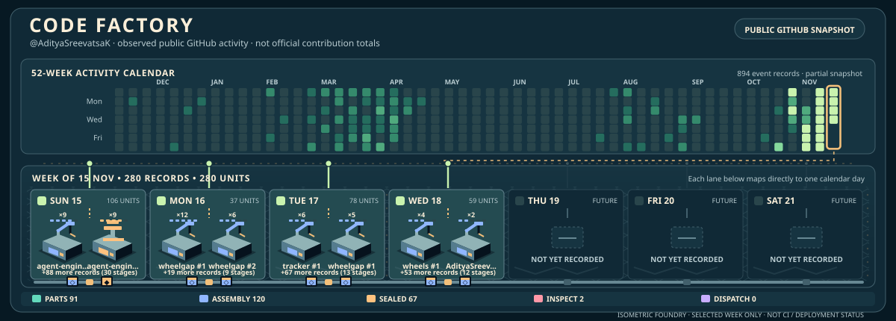
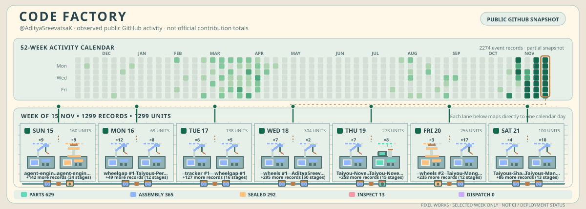

# Code Factory

**Turn observed public GitHub activity into a miniature working factory, driven by a familiar contribution-style calendar.**

Code Factory is an experimental, standalone, zero-dependency SVG visualisation. Each selected week expands into **seven production lanes**. Commits forge parts, opened pull requests assemble them, merged pull requests seal them, opened issues trigger inspection and releases dispatch cargo. All active machinery, parcels and counts are derived from input event records. Idle days produce nothing.

> **Accuracy:** This is an *observed public-activity* visualisation, **not GitHub's official contributions calendar**. Different event types have different counting semantics. PR opens and later merges are separate stages. The public collector cannot see all contributions, private repositories or every upstream/feature-branch commit.

## Automatically refreshed account showcase

[](https://github.com/AdityaSreevatsaK/Code-Factory/actions/workflows/refresh-activity.yml)

The images below use **observed public activity** from [@AdityaSreevatsaK](https://github.com/AdityaSreevatsaK). A GitHub Actions workflow refreshes the public snapshot and these SVGs **approximately every six hours**, subject to GitHub scheduling and API availability. The source timestamp is available in [the latest public snapshot](data/live-public-activity.json). On refresh failure, the previous validated images remain available.

### Isometric Foundry



### Pixel Works



Other automatically refreshed themes: [Isometric light](exports/live-isometric-light-still.svg) · [Pixel dark](exports/live-pixel-dark-still.svg). Each image highlights the **most recent observed active week**, including the current incomplete week when activity exists.

The original [17 November 2026 historical public snapshot](fixtures/adityasreevatsak-public-activity.json) and [frozen isometric preview](exports/account-isometric-dark-still.svg) are retained for reproducibility. The [synthetic demo](fixtures/demo-activity.json) remains a separate regression fixture. Neither is overwritten by scheduled refreshes.

## Data accuracy and calibrated activity

The first scheduled capture contained fewer observed events than the frozen historical example. An [exact public-data audit](docs/DATA_COVERAGE_AUDIT.md) traced **455 missing records to one owned repository absent from the earlier public-repository listing**. The account's public status was verified during the audit, but the reason for the earlier listing omission is not conclusively known.

The collector now re-verifies previously public owned repositories **without using an authentication token** before excluding them from a new capture. It does not retain or scan repositories that are no longer publicly accessible. API failures stop publication rather than producing a misleading update.

The heatmap also uses a **calibrated logarithmic five-level activity scale** based on the year's observed peak. A single event is visually different from dozens or hundreds. Five small load indicators in each daily workshop show the corresponding day’s intensity, and busy days prioritise the two most active real repository stages while disclosing the remainder.

To reproduce the capture comparison locally:

```powershell
npm run audit:coverage
npm test
npm run verify:exports
npm run verify:live
```

These are **observed source-event units**, not GitHub's official contribution totals. See the [draft improvement PR](https://github.com/AdityaSreevatsaK/Code-Factory/pull/1) for the visual changes and verification status.

### Working factory artwork (review branch)

Each observed machine now has stage-specific details, calibrated work lights and a short conveyor for its active day. Browser animation adds moving gears, belts and electrical feeds. Static profile SVGs retain the detail without relying on animation; idle days remain idle.

## Automatic refresh

- **Schedule:** 00:17, 06:17, 12:17 and 18:17 UTC, or manually from [Refresh public activity](https://github.com/AdityaSreevatsaK/Code-Factory/actions/workflows/refresh-activity.yml) using *Run workflow*.
- **Data source:** public GitHub PRs, issues, mergers and publicly owned default-branch commits. No private repository collection or official contribution-total claims.
- **Published files:** `data/live-public-activity.json` and the four `exports/live-*-still.svg` images, committed to `master` only after validation.
- **Safety:** the built-in GitHub Actions token is never committed. API failures, incomplete results or invalid SVGs prevent publication.
- **Cost:** GitHub-hosted Actions usage is subject to repository and account allowances. This workflow requires no paid API or separate server.

To check the current publication locally:

```powershell
npm test
npm run verify:live
npm run verify:exports
```

The scheduled job does **not** edit your GitHub profile, publish a release or change repository visibility. See [live refresh workflow](.github/workflows/refresh-activity.yml) and [architecture](docs/ARCHITECTURE.md) for implementation details.

## Generate a factory for any public GitHub username

Run **one command** with Node 20+. No source edits, fixture changes, paid API or installation required:

```powershell
node scripts/create-factory.mjs --username octocat --output output/octocat
```

This collects public-only activity and writes a validated snapshot, four static SVGs and a `README-embed.md` snippet to the selected directory. For offline input, use `--snapshot path/to/public-activity.json`. To produce directly usable absolute Markdown image links **after hosting the SVGs**, add `--asset-base-url https://raw.githubusercontent.com/OWNER/REPO/BRANCH/ASSET_DIRECTORY`.

Alternatively, fork the repository and run **Actions → Generate Code Factory for a public username → Run workflow**, then download the generated artefact. Workflow execution does not commit, host, or publish anyone's files automatically, and does not edit their profile. In a public fork, anyone with permission to run workflows can use it.

## Quick start

Requires **Node.js 20+** and optionally **Python 3.11+** for legacy artwork tests and the local preview server. No npm installation, paid service or GitHub token is required to render an existing snapshot.

```powershell
git clone https://github.com/AdityaSreevatsaK/Code-Factory.git
cd Code-Factory

# Render eight main theme/layout variants from the synthetic demo
node calendar-factory.mjs

# Render your own normalised JSON data to a separate output folder
node calendar-factory.mjs fixtures/demo-activity.json output --week-index 51

# All Node tests
npm test

# All Python tests (including retained legacy artwork)
python -m unittest discover -s tests -v

# Compare committed historical and live SVGs with deterministic regenerations
npm run verify:exports
npm run verify:live

# Interactive preview, with live-account/historical/demo switch
python -m http.server 8000
```

Visit **http://localhost:8000/preview.html**. Never open the preview using a `file://` URL; ES modules and fixture fetches need an HTTP server. You can select weeks by clicking the calendar, by keyboard, or with the week dropdown. Two themes, two art styles, mobile detail zoom and optional local-browser animation are available.

### Generate a public snapshot

```powershell
# Use a public GitHub username; a token is optional to improve rate limits.
node refresh-public-activity.mjs --username octocat --output fixtures/octocat-public-activity.json

# Render that specific snapshot; output stays separate from committed showcase SVGs.
node calendar-factory.mjs fixtures/octocat-public-activity.json output/octocat
```

The public collector only queries public PRs/issues and authored commits on public owned default branches. It rejects truncated search results and writes files atomically. For better API rate limits you may provide `GITHUB_TOKEN` in your local environment. **Never commit tokens or private snapshots.** The preview itself works offline from committed inputs.

### Windows verification

```powershell
.\verify.ps1
```

The script runs Node and Python tests, verifies all **18** committed SVGs: fourteen historical examples plus four live account images in temporary directories and compares them with the checked-in versions. To intentionally regenerate the committed assets, run `.\verify.ps1 -Regenerate`, inspect the diff, then commit it.

## Repository map

| Path | Responsibility |
| --- | --- |
| `calendar-factory.mjs` | Normalised input validation, 53-column calendar model and deterministic SVG rendering/CLI |
| `refresh-public-activity.mjs` | Public-only GitHub REST collection and snapshot CLI |
| `preview.html` | Standalone interactive browser preview, no framework |
| `fixtures/` | Frozen synthetic and historical public snapshots |
| `data/live-public-activity.json` | Automatically refreshed public account snapshot |
| `.github/workflows/refresh-activity.yml` | Approved six-hour public-only activity refresh |
| `exports/` | Four live account SVGs plus 14 frozen historical/demo SVGs |
| `tests/` | Node and Python regression tests, including public collector mocks |
| `scripts/` | Cross-platform generated-asset verification |
| `legacy/` | Preserved earlier Python factory prototype, **not** the current renderer |
| `docs/` | Architecture, design, contract, development, agent handover, metadata and roadmap |
| `AGENTS.md` | **Start here for AI coding agents**, then follow `docs/AI_AGENT_HANDOVER.md` |
| `.github/workflows/ci.yml` | Offline deterministic CI, no paid APIs or network-dependent tests |

## Data principles

- Uses a 53-week Sunday-start calendar with a highlighted seven-day workshop.
- One machine/parcel represents an observed repository and event stage on a specific day. Repeated records for the same repository and stage share a machine.
- Maximum two distinct machines are drawn per day; a truthful overflow message reports hidden stages. All valid source records still count towards the calendar.
- A blank day means **no observed event in the input**, not a proven absence of GitHub contributions.
- Only the synthetic fixture is marked `SYNTHETIC DEMO`; captured activity is marked `PUBLIC GITHUB SNAPSHOT`.
- GitHub READMEs use **still SVG files**. Optional SVG animation is designed for local browsers and is not claimed to run on GitHub.
- Rendering is offline, deterministic and free of external images, fonts, trackers and third-party JavaScript.

## Documentation

Read [Architecture](docs/ARCHITECTURE.md), [Data contract](docs/DATA_CONTRACT.md), [Design specification](docs/DESIGN_SPEC.md), [Development and testing](docs/DEVELOPMENT.md), [Security](SECURITY.md), [Contribution guide](CONTRIBUTING.md) and the [AI agent handover](docs/AI_AGENT_HANDOVER.md).

**Project status:** active experimental prototype, not yet a released library or officially verified GitHub-contributions replacement. Public repository visibility does not itself grant a licence to reuse the code. A source licence will be chosen before inviting third-party code contributions or publishing a stable release. No automated modification of anyone's GitHub profile is performed.

Migrated from the Code Factory experiment in [GitHub Activity Studio](https://github.com/AdityaSreevatsaK/GitHub-Activity-Studio/pull/5). Other Activity Studio concepts remain independent.
