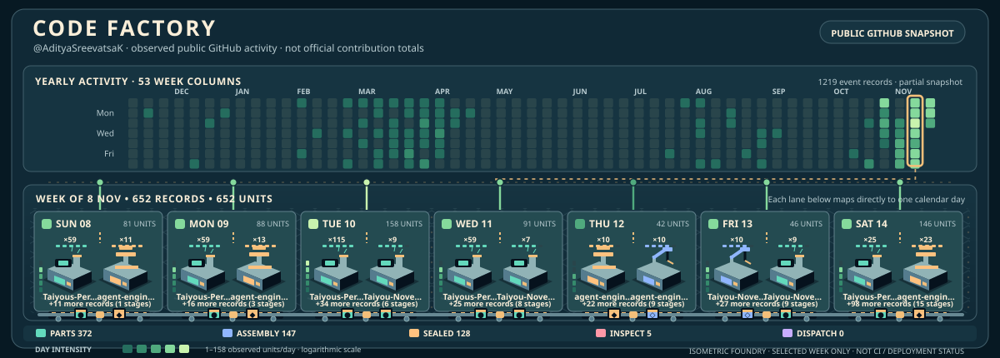
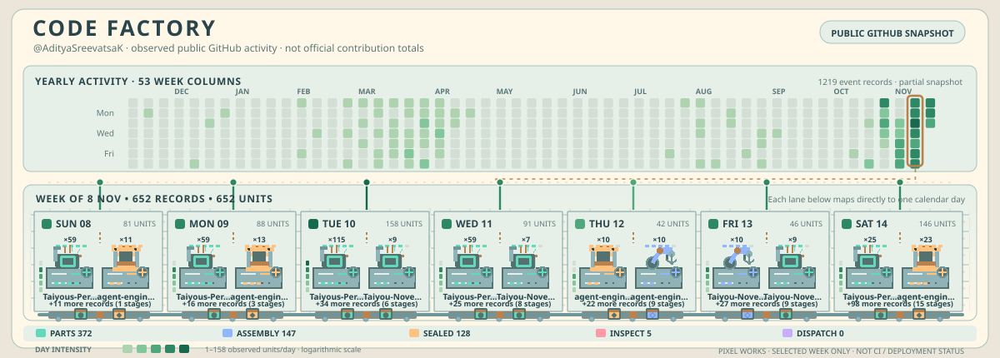

# Code Factory

**Turn observed public GitHub activity into a miniature working factory, driven by a familiar contribution-style calendar.**

Code Factory is an experimental, standalone, zero-dependency SVG visualisation. Each selected week expands into **seven production lanes**. Commits forge parts, opened pull requests assemble them, merged pull requests seal them, opened issues trigger inspection and releases dispatch cargo. All active machinery, parcels and counts are derived from input event records. Idle days produce nothing.

> **Accuracy:** This is an *observed public-activity* visualisation, **not GitHub's official contributions calendar**. Different event types have different counting semantics. PR opens and later merges are separate stages. The public collector cannot see all contributions, private repositories or every upstream/feature-branch commit.

## Account showcase

These images use a fixed public snapshot for [@AdityaSreevatsaK](https://github.com/AdityaSreevatsaK), captured on **17 November 2026**. They do not update automatically.

### Isometric Foundry



### Pixel Works



Other themes: [Isometric light](exports/account-isometric-light-still.svg) · [Pixel dark](exports/account-pixel-dark-still.svg). The selected example week is **8–14 November 2026**. For tests and visual comparisons, [synthetic demo imagery](exports/isometric-dark-still.svg) is supplied separately.

## Quick start

Requires **Node.js 20+** and optionally **Python 3.11+** for legacy artwork tests and the local preview server. No npm installation, paid service or GitHub token is required to render an existing snapshot.

```powershell
git clone https://github.com/AdityaSreevatsaK/Code-Factory.git
cd Code-Factory

# Render eight main theme/layout variants from the synthetic demo
node calendar-factory.mjs

# Render your own normalised JSON data to a separate output folder
node calendar-factory.mjs fixtures/demo-activity.json output --week-index 51

# All Node tests
npm test

# All Python tests (including retained legacy artwork)
python -m unittest discover -s tests -v

# Compare committed SVGs with deterministic regenerations
npm run verify:exports

# Interactive preview, with public-account/demo switch
python -m http.server 8000
```

Visit **http://localhost:8000/preview.html**. Never open the preview using a `file://` URL; ES modules and fixture fetches need an HTTP server. You can select weeks by clicking the calendar, by keyboard, or with the week dropdown. Two themes, two art styles, mobile detail zoom and optional local-browser animation are available.

### Generate a public snapshot

```powershell
# Use a public GitHub username; a token is optional to improve rate limits.
node refresh-public-activity.mjs --username octocat --output fixtures/octocat-public-activity.json

# Render that specific snapshot; output stays separate from committed showcase SVGs.
node calendar-factory.mjs fixtures/octocat-public-activity.json output/octocat
```

The public collector only queries public PRs/issues and authored commits on public owned default branches. It rejects truncated search results and writes files atomically. For better API rate limits you may provide `GITHUB_TOKEN` in your local environment. **Never commit tokens or private snapshots.** The preview itself works offline from committed inputs.

### Windows verification

```powershell
.\verify.ps1
```

The script runs Node and Python tests, regenerates all **14** committed SVGs in temporary directories and compares them with the checked-in versions. To intentionally regenerate the committed assets, run `.\verify.ps1 -Regenerate`, inspect the diff, then commit it.

## Repository map

| Path | Responsibility |
| --- | --- |
| `calendar-factory.mjs` | Normalised input validation, 53-column calendar model and deterministic SVG rendering/CLI |
| `refresh-public-activity.mjs` | Public-only GitHub REST collection and snapshot CLI |
| `preview.html` | Standalone interactive browser preview, no framework |
| `fixtures/` | Synthetic contract fixture and clearly labelled dated public showcase snapshot |
| `exports/` | 14 committed static/optional animated and historical-week SVG assets |
| `tests/` | Node and Python regression tests, including public collector mocks |
| `scripts/` | Cross-platform generated-asset verification |
| `legacy/` | Preserved earlier Python factory prototype, **not** the current renderer |
| `docs/` | Architecture, design, contract, development, agent handover, metadata and roadmap |
| `AGENTS.md` | **Start here for AI coding agents**, then follow `docs/AI_AGENT_HANDOVER.md` |
| `.github/workflows/ci.yml` | Offline deterministic CI, no paid APIs or network-dependent tests |

## Data principles

- Uses a 53-week Sunday-start calendar with a highlighted seven-day workshop.
- One machine/parcel represents an observed repository and event stage on a specific day. Repeated records for the same repository and stage share a machine.
- Maximum two distinct machines are drawn per day; a truthful overflow message reports hidden stages. All valid source records still count towards the calendar.
- A blank day means **no observed event in the input**, not a proven absence of GitHub contributions.
- Only the synthetic fixture is marked `SYNTHETIC DEMO`; captured activity is marked `PUBLIC GITHUB SNAPSHOT`.
- GitHub READMEs use **still SVG files**. Optional SVG animation is designed for local browsers and is not claimed to run on GitHub.
- Rendering is offline, deterministic and free of external images, fonts, trackers and third-party JavaScript.

## Documentation

Read [Architecture](docs/ARCHITECTURE.md), [Data contract](docs/DATA_CONTRACT.md), [Design specification](docs/DESIGN_SPEC.md), [Development and testing](docs/DEVELOPMENT.md), [Security](SECURITY.md), [Contribution guide](CONTRIBUTING.md) and the [AI agent handover](docs/AI_AGENT_HANDOVER.md).

**Project status:** active experimental prototype, not yet a released library or officially verified GitHub-contributions replacement. Public repository visibility does not itself grant a licence to reuse the code. A source licence will be chosen before inviting third-party code contributions or publishing a stable release. No automated modification of anyone's GitHub profile is performed.

Migrated from the Code Factory experiment in [GitHub Activity Studio](https://github.com/AdityaSreevatsaK/GitHub-Activity-Studio/pull/5). Other Activity Studio concepts remain independent.
