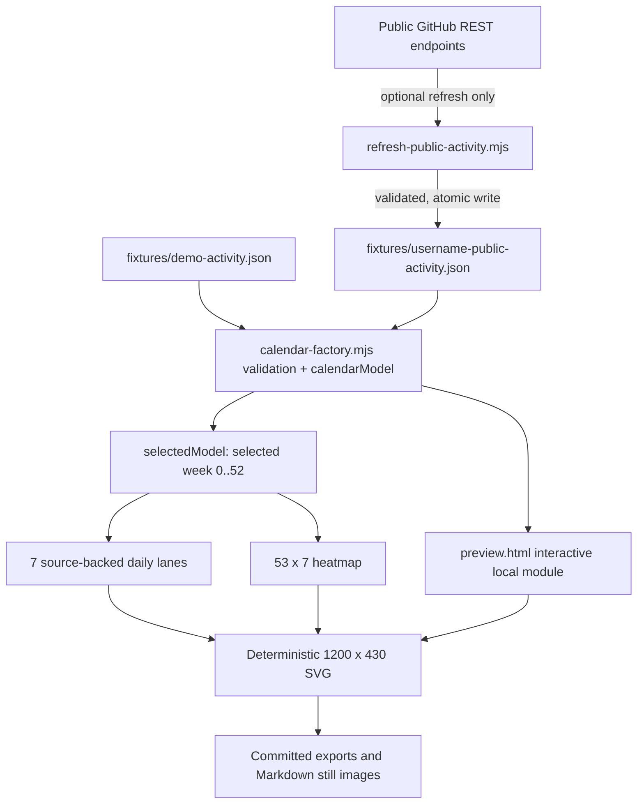

# Architecture

## Intent and trust boundaries

Code Factory has two independent pipelines:

1. **Optional collection:** query only observable public GitHub activity and persist a dated `schema_version: "1"` snapshot.
2. **Deterministic visualisation:** load a snapshot locally, normalise and validate it, group events into 53 weeks and seven days, then render a factory SVG. No GitHub API call is required for rendering or previewing.

**Boundary A, GitHub:** public query results are untrusted, incomplete and rate-limited. Offline CI remains read-only. A separate approved six-hour scheduled GitHub Actions workflow uses `contents: write` only to commit validated public snapshot and SVG outputs. Collection failure never overwrites a known-good snapshot.

**Boundary B, JSON:** snapshot schema/version, UTC timestamps, repository identity, IDs, counts and labels are validated before drawing. An event is not assumed equivalent to a GitHub contributions-calendar increment.

**Boundary C, SVG/browser:** escaped labels and safe, bounded geometry only. No third-party assets, remotely loaded fonts, external JavaScript, network scripts, inline HTML or claims of real CI deployments.

## Source tree

- `calendar-factory.mjs`: main rendering engine and CLI.
- `refresh-public-activity.mjs`: public REST collector with injectable `request` for offline mocks.
- `preview.html`: static single-page UI loading the renderer as a browser module, with a source switch between local JSON fixtures.
- `fixtures/`: frozen historical public and synthetic test fixtures.
- `data/live-public-activity.json`: approved scheduled public account snapshot.
- `scripts/generate-live.mjs` and `scripts/verify-live.mjs`: four live static SVGs derived deterministically from the current snapshot.
- `.github/workflows/refresh-activity.yml`: public-only collection, validation and scoped publication every six hours.
- `exports/`: the committed SVG deliverables. They are build outputs whose correctness is checked against the exact source renderer.
- `tests/`: Node model, collector and Python XML integrity/legacy tests.
- `scripts/verify-exports.mjs`: validates exact committed image reproduction cross-platform.
- `legacy/factory.py`: original pre-calendar Python design, kept separate for historical comparison.

## Renderer data flow

`validSnapshot(input)` verifies `schema_version`, source, bounds and UTC timestamps; maps repository `full_name` to canonical names; rejects conflicting IDs and dangerous XML characters; returns deduplicated chronological events and a `generated` snapshot time. It uses no I/O or system clock.

`calendarModel(input)` derives **53 Sunday-start week buckets** from the snapshot's `generated_at` UTC day: the preceding 52 complete weeks plus the current week. Every week contains seven days in Sunday-Saturday order. Each event is assigned by its real UTC time. Events outside the window or beyond the snapshot cutoff increment the disclosed filtered count. Days in the incomplete current week that have not yet occurred are marked future.

`selectedModel(input,weekIndex?)` chooses an explicit 0..52 column, or the latest week that contains observed data. It returns the current week and aggregates source-backed active repositories and stage counts.

`dayMachines(day)` groups same-repository + same-event-stage records into one machine per day, preserving sum of units, number of source records, and source IDs. The renderer draws at most two distinct stages per day and reports overflow records/stages; all input records still affect the heatmap.

`render(input,{layout,theme,animated,selectedWeek})` draws in this order: background/typography, 53×7 grid and selected column, seven day-level signal links, seven machine floors, event-specific machinery and source-backed cargo, and the summary/legend. Both isometric and pixel styles use original procedural SVG geometry. It is pure and deterministic.

The CLI at the bottom of the module loads Node built-ins **only when invoked directly**. Browser imports must remain free from `node:` module dependencies.

## Collector boundaries and behaviour

The public collector uses GitHub REST:
- `GET /search/issues` with `author:<login> is:pr is:public` or `is:issue is:public`, filtered by creation date.
- `GET /users/<login>/repos?type=owner` to discover owned repositories, then filters the returned records to `private === false`, `visibility === "public"` and exact login ownership.
- `GET /repos/<owner>/<repo>/commits` for author, start/end date and the **public default branch only**.

The renderer accepts a `release` event in schema v1, but the built-in collector does not currently call the releases API. Do not describe release collection as implemented.

It handles GitHub search limits, page boundaries, malformed responses and API failures. A snapshot is written first to a temporary file and atomically renamed only when the full collection succeeds. A token can be supplied via environment variable to increase rate limits, but is not saved or exposed.

### Exclusions and coverage limits

This public-REST strategy does **not** obtain GitHub's authoritative per-day contribution count. It generally misses commits only on feature branches, some external organisation/upstream work, restricted activity and private data. A PR open and merge are independent observed stages even when GitHub credits them differently. Document these omissions prominently.

## Browser architecture

`preview.html` is intentionally framework-free. It imports `calendar-factory.mjs`, fetches only **same-repository local fixture JSON**, and embeds the freshly rendered SVG into the page. Users can switch between the dated account dataset and the synthetic demo, choose a week with chart clicks or keyboard, inspect a seven-day ledger, change layout/theme/motion and zoom horizontally on mobile.

Never require a live GitHub token in the browser. Launch through a local HTTP server, not `file://`.

## Asset matrix and provenance

18 committed SVGs:
- Demo: 2 layouts × 2 themes × animated/still = 8
- Two fixed alternate demo weeks: release week 48, inspection week 45
- Frozen personal historical showcase: 2 layouts × 2 themes × still only = 4, pinned week 51
- Live public account showcase: 2 layouts × 2 themes × still only = 4, selected latest observed active week

`scripts/verify-exports.mjs` generates 14 historical assets in memory from the corresponding committed fixture and compares exact content, normalising only CRLF/LF. `verify.ps1` additionally runs native test suites and checks independent CLI-produced files. Derived images must be regenerated whenever the renderer or fixtures change.

## Performance model and constraints

Validation is bounded to at most 5,000 repositories and 10,000 event records per snapshot. Event `count` is an integer of 1..100,000. Rendering avoids one graphic machine per raw event and groups per day. The SVG dimensions are 1200 × 430, with a 150 KB per-file test budget. Future optimisation must retain data integrity and a readable, recognisable calendar.

## Compatibility and extensibility

The v1 JSON contract is intentionally independent of any collector implementation. A future alternative source can produce a compatible snapshot, but its provenance and semantics must be explicitly documented. Do not couple UI state to API calls, do not change the contract silently, and do not move this code into another Activity Studio visualisation. First-party Node APIs and standalone SVG are the baseline; new runtime dependencies require a design justification and tests.
